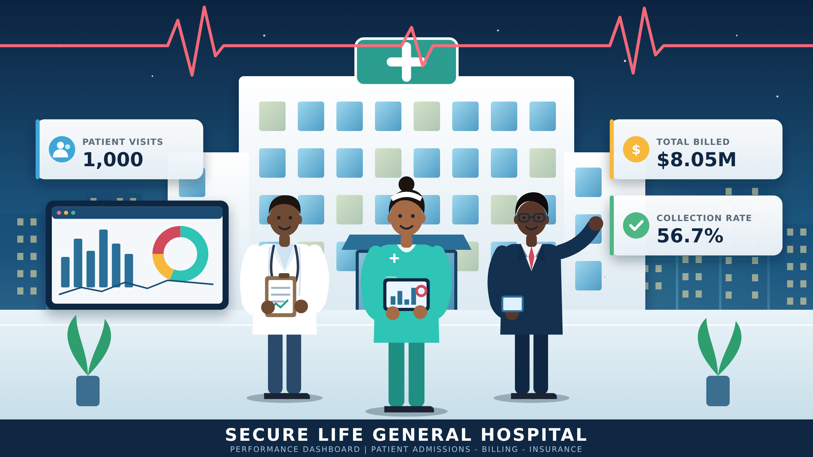
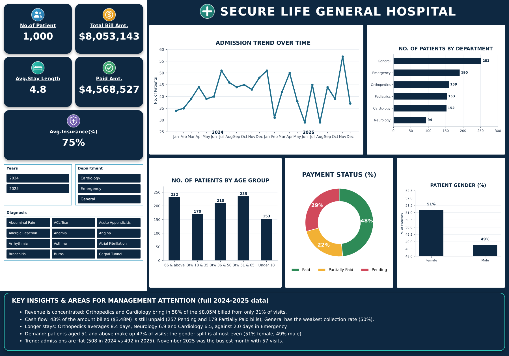

# PERFORMANCE-DASHBOARD-Patient-Admissions-Billing-Insurance-Analysis

## INTRODUCTIOIN

Hospitals generate large amounts of data every day, from who is admitted and how long they stay, to what they are billed and how much of that bill is actually paid. Without a clear summary, it is hard for management to see where the hospital is performing well and where money or capacity is being lost.
This project analyses admission, billing and insurance records from Secure Life General Hospital. Using Microsoft Excel, the raw records were cleaned, summarised with PivotTables and turned into an interactive dashboard (PivotCharts, KPI cards and slicers) that management can use to monitor operational and financial performance and support decisions.

## ABOUT THE DATASET
The dataset contains 1,000 patient visits recorded between January 2024 and December 2025, across 6 departments and 38 diagnoses. Each row is one patient visit, not necessarily one unique patient: the 1,000 visits belong to 684 distinct patient names, so some patients appear more than once.

| Field | Description |
|:------|:------------|
| Patient ID | Unique ID for each patient visit or record |
| Patient Name | Name of the patient who received care |
| Age / Gender | Patient age in years and recorded gender |
| Admission Date / Discharge Date | Dates the patient was admitted and discharged |
| Department | Department that treated the patient (Cardiology, Emergency, General, Neurology, Orthopedics, Pediatrics) |
| Diagnosis | Medical condition recorded for the patient |
| Total Bill Amount | Total amount charged for treatment and services |
| Insurance Coverage (%) | Share of the bill covered by the patient's insurance |
| Payment Status | Paid, Pending or Partially Paid |

**Columns added during analysis**
- **Percentage Amt calc**: the part of the bill covered by insurance (bill x coverage %).
- **Amount Payable**: the part of the bill the patient pays (bill minus insurance).
- **Average Length of Stay**: days between admission and discharge dates.
- **Paid Amount**: the full bill for visits with status Paid and 0 otherwise.
- **Age estimate**: age category (Under 18, 18-35, 36-50, 51-65, 66 and above).

  
**Data cleaning note**

In the source file the Average Length of Stay formula points at the wrong rows for 991 of the 1,000 visits. The overall average still rounds to 4.8 days, and the department-level stay figures in the Insights below were recalculated directly from the admission and discharge dates. The dataset does not record how much of a Partially Paid bill was settled, so those bills are treated as $0 collected, which means the unpaid figure is an upper bound.

## PROBLEM STATEMENT
The management of Secure Life General Hospital has observed a change in patient admissions, outstanding medical bills and variations in insurance coverage across its departments. The hospital lacks a consolidated report that gives a clear picture of its operational and financial performance. The analysis needed to help management answer these questions:

1.How many patient visits has the hospital recorded?

2.Which departments receive the highest number of patients?

3.Which departments generate the highest total bills?

4.What is the average length of stay for patients across departments?

5.What proportion of bills has been paid, remains pending, or has been partially paid?

6.How much has the hospital billed, and how much remains outstanding?

7.How does insurance coverage vary across departments and diagnoses?

8.Which age groups account for the highest number of patient visits?

9.How do admissions and billing amounts change over time?

10.Which areas may require management attention?

## VISUALIZATION
The dashboard has five KPI cards (patients, total bill, average stay, amount paid, average insurance coverage), five PivotCharts (admission trend, patients by department, age group, payment status and gender) and a key-insights panel. Three slicers (Years, Department and Diagnosis) filter every number and chart. The image below shows the unfiltered view; the interactive version is in the Excel workbook.

## INSIGHTS
1. Visits
The hospital recorded 1,000 patient visits. General receives the most patients (252), followed by Emergency (190), Orthopedics (159), Pediatrics (153) and Cardiology (152). Neurology is the smallest with 94.
2. Billing
Total billing is $8,053,143. Volume does not match revenue: Orthopedics ($2.55M) and Cardiology ($2.10M) generate 58% of all billing from only 31% of visits, because their average bill ($16,062 and $13,786) is about four times that of General ($3,941), Emergency or Pediatrics.
3. Length of stay
The average stay is 4.8 days. Orthopedics has the longest (8.4 days), then Neurology (6.9) and Cardiology (6.5). Emergency has the shortest at 2.0 days.
4. Payment and outstanding balance
56.4% of bills are fully paid, 25.7% are pending and 17.9% are partially paid. Of the $8.05M billed, $4.57M (56.7%) has been collected and up to $3.48M (43%) is outstanding. The payment-status donut on the dashboard is based on the amount payable by patients (48% paid, 22% partially paid, 29% pending); by number of bills the split is 56% / 18% / 26%. Orthopedics and Cardiology alone hold about $1.99M of that. General has the weakest collection rate (50%) and Pediatrics the highest share of pending bills (29%).
   
| Department | Visits | Total billed | Avg stay (days) | Collection rate |
|:-----------|-------:|-------------:|----------------:|----------------:|
| General | 252 | $993,027 | 3.9 | 50% |
| Emergency | 190 | $622,525 | 2.0 | 60% |
| Orthopedics | 159 | $2,553,862 | 8.4 | 57% |
| Pediatrics | 153 | $572,988 | 3.0 | 55% |
| Cardiology | 152 | $2,095,438 | 6.5 | 57% |
| Neurology | 94 | $1,215,303 | 6.9 | 60% |

6. Insurance coverage
Average coverage is 74.9% and is very similar across departments (73.9% to 76.3%). It varies much more by diagnosis: Asthma (62%), Arrhythmia (64%) and Epilepsy (68%) have the lowest average coverage, while Coronary Artery Disease (83%), Stroke (82%) and RSV (81%) have the highest. 44 visits had no insurance coverage at all.
7. Age groups
Patients aged 51 to 65 (235 visits) and 66 and above (232) account for the most visits, together 47% of the total. They are followed by ages 36 to 50 (210), 18 to 35 (170) and under 18 (153).
8. Gender
Female patients account for 512 visits (51.2%) and male patients for 488 (48.8%), an almost even split.
9. Trends over time
Admissions were almost flat: 508 visits in 2024 against 492 in 2025, while billing fell 5.1% from $4.13M to $3.92M. Monthly volume is uneven with no clear seasonal pattern. November 2025 was the busiest month (57 visits, $510,414), while June and August 2025 were the quietest (29 visits each).

## RECOMMENDATION
- Strengthen debt collection. Set up reminders, payment plans and follow-up for the 436 pending and partially paid bills, starting with Orthopedics and Cardiology where the largest balances sit.
- Improve billing in General. It has the lowest collection rate (50%); review its invoicing and follow-up process.
- Plan bed capacity and discharge. Orthopedics, Neurology and Cardiology keep patients 6.5 to 8.4 days; review discharge planning and bed allocation to avoid bottlenecks.
- Support patients with low or no coverage. Verify insurance before admission, and offer financial counselling for diagnoses such as Asthma, Arrhythmia and Epilepsy, and for the 44 visits with no cover.
- Staff for the busiest periods and age groups. Plan staffing around peak months such as November, and around the 51+ age groups that make up almost half of visits.
- Investigate the drop in billing. Billing fell 5.1% in 2025 with similar visit numbers; check for pricing, case-mix or write-off changes.
- Improve data quality. Record the amount paid on partially paid bills so outstanding balances can be measured precisely.

## CONCLUSION
The hospital’s patient volume is healthy and fairly stable, but its finances are under strain: more than 40% of what it bills has not been collected. Revenue is concentrated in Orthopedics and Cardiology, which are also the departments with the longest stays and the biggest unpaid balances, so improvements there will have the greatest effect. This dashboard gives management a single view to track visits, billing, collections, stay length and insurance cover, and to act on the areas highlighted above.
